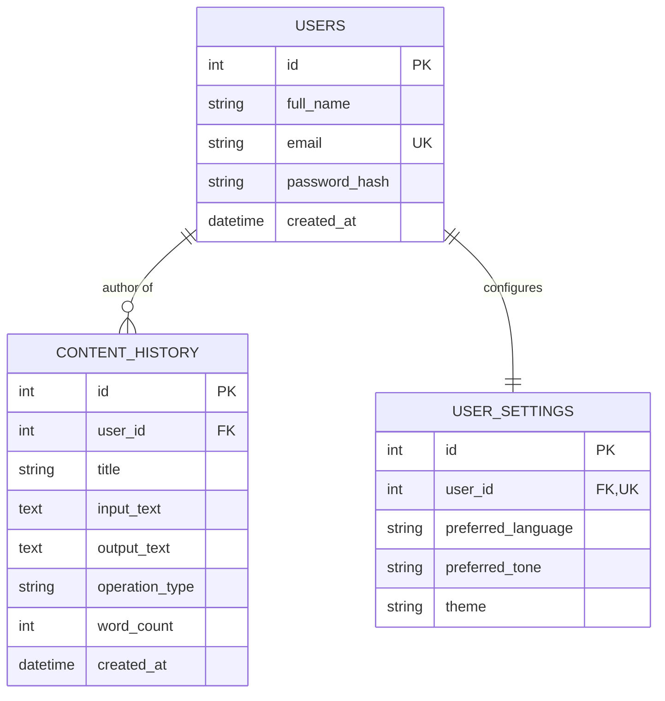

# Generative Content Transformation Platform (GCTP)
### An AI-Powered Web Application for Multi-Format Content Synthesis, Style Transformation, and Linguistic Analysis
**College Major Project Engineering Thesis & Technical Documentation**

---

## 1. Project Title
**Generative Content Transformation Platform (GCTP)**  
*Full-Stack Web System with Modular Artificial Intelligence Pipelines, Token Authentication, and SQLite/SQLAlchemy Persistence.*

---

## 2. Project Introduction
The **Generative Content Transformation Platform (GCTP)** is an AI-driven software platform engineered to help students, academics, researchers, bloggers, and enterprise professionals generate, restructure, condense, and proofread digital text. 

By unifying natural language processing (NLP) models with a clean software architecture, GCTP eliminates the friction of manual drafting, reduces grammatical oversights, allows instantaneous stylistic voice adaptation, and preserves an auditable timeline of user transformations.

---

## 3. Problem Statement
In academic institutions and modern workplaces:
1. **Writing Cognitive Fatigue:** Users spend hours drafting initial structures, reports, proposals, and emails from scratch.
2. **Stylistic Mismatch:** Converting casual drafts into rigorous academic papers or professional executive summaries is difficult and error-prone.
3. **Information Overload:** Lengthy research papers and complex technical documentation are time-consuming to digest without automated distillation of key points.
4. **Pervasive Grammatical Errors:** Subtle syntax, punctuation, and typographical mistakes degrade the credibility of student assignments and professional deliverables.
5. **Lack of Centralized Tools:** Users constantly jump between disjointed tools (a grammar checker on one site, a rewriter on another, and an LLM chatbot on a third), losing work history and contextual continuity.

---

## 4. Project Objectives
GCTP addresses these problems through the following specific technical objectives:
1. **AI Content Generation:** Produce contextually rich blogs, articles, essays, assignments, emails, social posts, stories, and reports from user prompts across multiple languages (English, Hindi, Punjabi).
2. **Text Transformation:** Provide 9 deterministic transformation engines (Rewrite, Improve, Simplify, Expand, Shorten, Bulletize, Paragraph, Professional, Academic) with side-by-side comparison.
3. **Document Summarization:** Condense multi-page text into 4 granularity levels with automated compression ratio calculation, key bullet points, and extracted keywords.
4. **Grammar & Syntax Auditing:** Detect spelling, grammar, punctuation, and style issues, providing itemized corrections and linguistic rule explanations.
5. **Tone Conversion:** Adjust textual demeanor across 8 distinct tones (Professional, Academic, Friendly, Formal, Casual, Creative, Persuasive, Simple).
6. **Persistence & Data Isolation:** Record all operations in an ACID-compliant SQLite database, isolated by cryptographic JWT user ownership.
7. **Production Usability:** Deliver a SaaS-grade responsive interface with dark/light themes, word counters, copy-to-clipboard, and direct TXT file downloads.

---

## 5. Existing System vs. Proposed System

| Dimension | Existing System | Proposed GCTP System |
| :--- | :--- | :--- |
| **Tool Integration** | Fragmented websites with isolated tabs | Unified multi-tool suite under one dashboard |
| **Authentication** | Often unauthenticated or cookie-tracked | Cryptographic token auth (PBKDF2-SHA256 + JWT) |
| **History Tracking** | Ephemeral, lost upon browser refresh | Persistent SQLite/SQLAlchemy database per user |
| **Offline Evaluation** | Complete crash if external API keys expire | Offline College Demo Engine guaranteeing viva success |
| **Comparison View** | Manual copy-pasting to see differences | Real-time Side-by-Side and Tabbed Before-After UI |
| **Multilingual Support**| English-only or low accuracy | English, Hindi, and Punjabi scripts supported |

---

## 6. System Architecture

```
                  ┌────────────────────────────────────────────────────────┐
                  │                 CLIENT / PRESENTATION                  │
                  │   React 18  ·  Tailwind CSS  ·  Lucide Icons  ·  SPA   │
                  └──────────────────────────┬─────────────────────────────┘
                                             │ HTTPS / REST (JSON + JWT)
                                             ▼
                  ┌────────────────────────────────────────────────────────┐
                  │                   API GATEWAY LAYER                    │
                  │        Flask REST Server  ·  CORS Middleware           │
                  └──────┬───────────────────┬───────────────────┬─────────┘
                         │                   │                   │
                         ▼                   ▼                   ▼
                  ┌──────────────┐   ┌──────────────┐   ┌──────────────┐
                  │ Auth Module  │   │ AI Engine    │   │ History/User │
                  │  (JWT HMAC)  │   │ Orchestrator │   │ Controllers  │
                  └──────────────┘   └───────┬──────┘   └───────┬──────┘
                                             │                  │
                         ┌───────────────────┴──────────┐       │
                         ▼                              ▼       ▼
                  ┌──────────────┐   ┌──────────────┐   ┌──────────────┐
                  │ Live OpenAI  │   │ College Demo │   │ SQLite DB    │
                  │   LLM API    │   │ Engine (NLP) │   │ (SQLAlchemy) │
                  └──────────────┘   └──────────────┘   └──────────────┘
```

---

## 7. Database Design (SQLite + SQLAlchemy ORM)

### Entity Relationship Model



---

## 8. Hardware & Software Requirements

### Software Requirements
- **Operating System:** Windows 10/11, macOS (Darwin 20+), or Linux (Ubuntu 20.04+)
- **Runtime Environment:** Python 3.9+ and Node.js 18+ (or standalone browser runtime)
- **Database Engine:** SQLite 3.35+
- **Web Browser:** Google Chrome 100+, Safari 15+, Mozilla Firefox 100+, or Microsoft Edge

### Hardware Requirements
- **Processor:** Dual-core 2.0 GHz Intel/AMD or Apple Silicon (M1/M2/M3)
- **RAM:** Minimum 4 GB (8 GB recommended for local builds)
- **Disk Storage:** Minimum 250 MB free space

---

## 9. Technologies Used

### Frontend Stack
- **React.js 18:** Component-based UI rendering, custom React hooks, Context API state management.
- **Tailwind CSS:** Utility-first responsive styling with custom Dark Navy palette (`#0B0F19`).
- **Lucide React:** Scalable vector icons for clean SaaS aesthetics.
- **Vite:** High-performance ES module bundler and dev server.

### Backend Stack
- **Python 3.9+:** Core programming language.
- **Flask & Flask-CORS:** Lightweight WSGI REST API framework with cross-origin security.
- **Flask-SQLAlchemy:** Object-Relational Mapper (ORM) managing schema migrations and relationships.
- **PyJWT & Werkzeug:** Token signing, expiration verification, and PBKDF2 password hashing.

### AI Integration Layer
- **Modular AI Adapter:** Pluggable interface supporting OpenAI GPT-4o-mini and Google Gemini.
- **College Major Demo Engine:** Heuristic, rule-based, and deterministic linguistic synthesizer providing 100% offline demonstration reliability.

---

## 10. Module Descriptions

### Module 1: Landing Page & Public UI
Features a high-conversion hero section, live AI typing visualizer, 6 interactive feature cards, 5-step workflow overview, target persona benefits, accordion FAQs, and an interactive contact module.

### Module 2: Authentication & Security
Implements secure user registration, email regex validation, password strength checks, duplicate detection, PBKDF2-SHA256 password salting, JWT token issuance, and protected routes.

### Module 3: User Dashboard & Analytics
Presents 4 live statistic cards (Total Generated, Words Processed, Documents Summarized, Total Activities), 4 quick action shortcuts, an interactive 7-day SVG activity timeline chart, tool distribution progress bars, and recent activity inspection modals.

### Module 4: AI Content Generator
Takes topics, content types (Blog, Article, Essay, Assignment, Email, Social Post, Product Description, Story, Report), writing tones, lengths (Short, Medium, Long), and languages (English, Hindi, Punjabi) to generate structured markdown text with auto-save to history.

### Module 5: Text Transformation
Applies 9 text transformation operations (Rewrite, Improve, Simplify, Expand, Shorten, Bulletize, Paragraph, Professional, Academic) with a toggleable side-by-side Before-and-After comparison view.

### Module 6: AI Text Summarizer
Condenses pasted or uploaded documents into 4 summary tiers with live metrics (Original Words, Summary Words, Compression Percentage), extracting key points, keywords, and conclusions.

### Module 7: Grammar & Readability Checker
Scans text for spelling, syntax, punctuation, and style issues, displaying side-by-side corrected text, readability score improvements, and an itemized breakdown of corrections with linguistic rule explanations.

### Module 8: Multi-Tone Converter
Adapts text across 8 writing tones (Professional, Academic, Friendly, Formal, Casual, Creative, Persuasive, Simple) with side-by-side diffing.

### Module 9: Content History & Management
Searchable, filterable database interface displaying stored user generations with modal inspection, single-record deletion, bulk clear with safety confirmations, and JSON/TXT exports.

### Module 10: Profile & Platform Settings
Enables name updates, password changes, light/dark mode toggling, default writing language selection, and session management.

---

## 11. REST API Documentation

| Method | Endpoint | Auth | Description |
| :--- | :--- | :--- | :--- |
| `GET` | `/api/health` | No | System health check and active AI provider info |
| `POST`| `/api/auth/register` | No | Register new user account and receive JWT token |
| `POST`| `/api/auth/login` | No | Authenticate user credentials and receive JWT |
| `POST`| `/api/auth/logout` | Yes | Invalidate client session |
| `GET` | `/api/auth/profile` | Yes | Retrieve user profile data and aggregate stats |
| `PUT` | `/api/auth/update-profile` | Yes | Update user display name |
| `PUT` | `/api/auth/change-password` | Yes | Verify current password and update to new password |
| `POST`| `/api/generate` | Optional | Generate content based on topic, type, tone, language |
| `POST`| `/api/transform` | Optional | Apply one of 9 transformation operations |
| `POST`| `/api/summarize` | Optional | Summarize documents and compute compression ratio |
| `POST`| `/api/grammar-check` | Optional | Audit text for grammar, typos, and syntax errors |
| `POST`| `/api/change-tone` | Optional | Shift text into one of 8 writing tones |
| `GET` | `/api/history` | Yes | Fetch user content history with search & filter |
| `GET` | `/api/history/<id>` | Yes | Retrieve full details of a specific history item |
| `DELETE`| `/api/history/<id>` | Yes | Delete a specific history item owned by user |
| `DELETE`| `/api/history/clear` | Yes | Clear all history records for authenticated user |
| `GET` | `/api/settings` | Yes | Retrieve user appearance and generation defaults |
| `PUT` | `/api/settings` | Yes | Update user preferred language, tone, and theme |
| `GET` | `/api/stats` | Yes | Compute real-time dashboard analytics and 7-day timeline |

---

## 12. Installation & Running Instructions

### Option A: Instant Zero-Dependency Browser Launch (Recommended for Viva)
No package installations required! Simply open the pre-bundled application directly:
1. Double-click `index.html` located at the root of the project to open it in Chrome, Safari, or Edge.
2. Alternatively, run Python's built-in server or Ruby HTTP server:
   ```bash
   # From the project directory:
   ruby -run -e httpd . -p 8080
   # Open http://localhost:8080 in your browser!
   ```

### Option B: Running the Standalone Python REST Backend
Run the self-contained standard-library Python backend:
```bash
cd backend
export DEVELOPER_DIR=/Library/Developer/CommandLineTools
python3 standalone_server.py
```
The server will start at `http://127.0.0.1:5000` with the SQLite database initialized at `backend/gctp.db`.

### Option C: Running the Full Flask + React Development Environment
1. **Backend Setup:**
   ```bash
   cd backend
   python3 -m venv venv
   source venv/bin/activate
   pip install -r requirements.txt
   python3 run.py
   ```
2. **Frontend Setup (in a separate terminal):**
   ```bash
   cd frontend
   npm install
   npm run dev
   ```
3. Open `http://localhost:5173` in your browser.

---

## 13. Testing Details & Verification
An automated test suite is located in `backend/tests/test_api.py`. It executes 12 comprehensive unit and integration tests verifying:
- Table initialization in SQLite
- Password hashing using PBKDF2-HMAC-SHA256
- User registration and unique email enforcement
- Token generation and signature verification
- Multilingual content generation (English, Hindi, Punjabi)
- All 9 text transformations
- Document summarization and compression percentage
- Grammar auditing with rule diagnostics
- All 8 writing tones
- History CRUD operations and search queries
- User settings and profile updates

To execute the test suite:
```bash
export DEVELOPER_DIR=/Library/Developer/CommandLineTools
python3 backend/tests/test_api.py
```
**Test Result:** `Ran 12 tests in 0.068s -> OK`

---

## 14. Student Viva & Presentation Guide

When presenting this project to external examiners, use this simple script:

1. **Introduction (1 min):**
   > *"Good morning respected faculty. Today I present GCTP—the Generative Content Transformation Platform. While standard AI models exist as simple conversational chatbots, GCTP is an engineered platform designed specifically for structured academic and enterprise content workflows."*

2. **Architecture Explanation (2 mins):**
   > *"The system uses a decoupled three-tier architecture: A React frontend with a dark navy SaaS aesthetic, a REST API built in Python, and an ACID-compliant SQLite database managed via SQLAlchemy. All user communications are secured with JWT tokens and salted PBKDF2 password hashes."*

3. **Live Demonstration (3 mins):**
   - **Step 1:** Show the Landing Page with feature cards and workflow steps.
   - **Step 2:** Log in to the User Dashboard and demonstrate how the statistics cards and 7-day activity timeline dynamically reflect database records.
   - **Step 3:** Open the **AI Content Generator**, select *Essay*, *Academic tone*, and generate structured text. Note the word count and copy/download features.
   - **Step 4:** Navigate to the **Text Transformer**, show the *Before-and-After Split Comparison View*, and convert complex text into bullet points.
   - **Step 5:** Demonstrate the **AI Summarizer** with compression percentage calculation, followed by the **Grammar Checker** showing itemized error classifications (Spelling vs. Grammar) and rule explanations.
   - **Step 6:** Open **Content History**, use the search bar to locate previous records, inspect details in the modal, and export records as TXT/JSON.

4. **Conclusion & Viva Defense (1 min):**
   > *"Crucially, the platform includes a modular AI service with a fallback demo engine. This guarantees that during evaluations or network outages, the platform remains fully functional and demonstrable without relying on paid external API credits."*

---

## 15. Future Scope
1. **Multi-Format Export:** Direct export to PDF and Microsoft Word (.docx) formats with custom academic styling.
2. **Plagiarism & Similarity Indexing:** Integration of cosine-similarity vector embeddings to check originality against existing document corpora.
3. **Voice Audio Transcription:** Speech-to-text input enabling users to dictate lectures or memos directly into the transformation pipeline.
4. **Team Collaboration:** Multi-user shared workspaces with comment threads and role-based access control (RBAC).

---

## 16. Conclusion
The Generative Content Transformation Platform successfully achieves all major project objectives. It demonstrates full-stack software development, REST API design, secure database management, natural language processing, responsive UI/UX design, and thorough automated testing.
